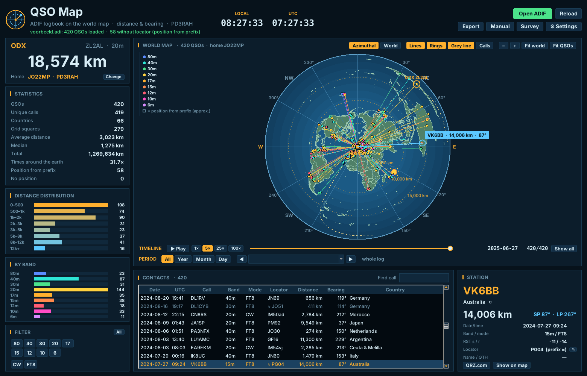
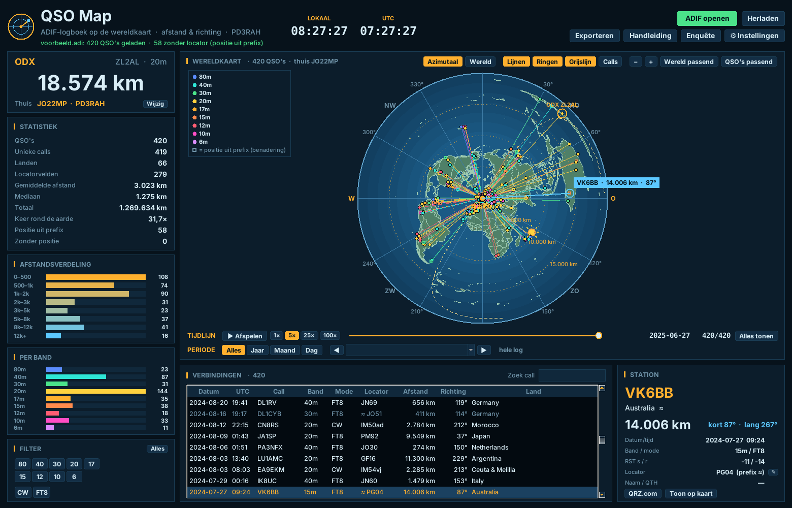

# QSO Map

**English** · [Nederlands](#nederlands)

A free Windows program that shows the contacts in your ADIF logbook on a world map, with the
distance and bearing of every station. Same look and feel as [CW Station](https://github.com/PD3RAH/cw-station).

*Screenshot with the included example log (fictitious contacts).*

## Features

- **Open any ADIF (.adi) file** from your logger, or the CW Station logbook with one click.
- **Azimuthal equidistant map** centred on your QTH (true distance and bearing, straight lines are
  great circles) and a **flat world map** with curved great-circle paths.
- **Distance and bearing** per contact, short and long path; **ODX** highlighted.
- Position from `LAT/LON`, `GRIDSQUARE`, or estimated from the **callsign prefix**.
- **Statistics**: QSOs, unique calls, countries, grid squares, average/median/total distance,
  distance distribution and QSOs per band.
- **Edit a wrong locator** per contact; corrections go into the exported ADIF.
- **Filters** on band, mode and callsign; sortable contact table.
- **Period**: view one year, month or day; **timeline** plays back your log in chronological order.
- **Grey line** with sun position, **distance rings** and compass rose.
- **Export**: ADIF with `DISTANCE`, CSV for Excel, map as PostScript.
- **Automatic updates** from GitHub (downloaded, checked, installed, restarted) and a short **survey**.
- English and Dutch, 6 colour themes, bright or dark map, scales with the screen. Your log is never modified.

**Manual:** [English](docs/MANUAL.md) · [Nederlands](docs/HANDLEIDING.md)

## Installation

Download `QSOMap-Setup-x.y.z.exe` from [Releases](../../releases) and run it. No admin rights
needed, Python is included. The installer is not code-signed, so Windows SmartScreen may show
*"Windows protected your PC"*: click *More info → Run anyway*.

Running from source: Python 3.10+ with tkinter, then `python src/qso_map.py [log.adi]`.
No other packages are needed.

## Building

`python installer/build_installer.py` (Linux, needs `nsis`, `pip install zstandard markdown`).
GitHub Actions builds the installer automatically for every `v*` tag.
The map data is made with `python tools/make_world.py countries-50m.json src/world.json`
from [world-atlas](https://github.com/topojson/world-atlas) (Natural Earth, public domain).

## Survey page

`web/qsomap/enquete.php` is the survey. Upload it to `www.pd3rah.nl/qsomap/enquete.php` (PHP with `mail()`);
answers are e-mailed to the address in `$MAIL_TO` and nothing is stored on the server.

## Releasing

Push a tag `vX.Y.Z` (with `APP_VERSION` in `src/qso_map.py` set to the same version). GitHub Actions builds
`QSOMap-Setup-X.Y.Z.exe` and the small `QSOMap-Update-X.Y.Z.exe` and attaches both to the release; the
automatic update in the program uses the Update file.

## License

MIT License, © 2026 Richard A. Hendriksen (PD3RAH) · [www.pd3rah.nl](https://www.pd3rah.nl).
See [THIRD_PARTY_NOTICES.md](THIRD_PARTY_NOTICES.md).

---

## Nederlands

Een gratis Windows-programma dat de verbindingen uit je ADIF-logboek op de wereldkaart zet, met de
afstand en richting van elk station. Zelfde uiterlijk als CW Station.

- Open elk ADIF-bestand (.adi) uit je logprogramma, of met één klik het CW Station-logboek.
- **Azimutale kaart** rond je eigen QTH (exacte afstand en richting) en een **platte wereldkaart**.
- Afstand en richting (kort en lang pad) per verbinding, ODX gemarkeerd.
- Positie uit `LAT/LON`, `GRIDSQUARE` of geschat uit het **prefix** van de roepnaam.
- **Foute locator aanpassen** per verbinding; de correctie gaat mee in de ADIF-export.
- Statistiek, afstandsverdeling, QSO's per band, filters op band/mode/call en een sorteerbare tabel.
- **Automatisch bijwerken** vanaf GitHub en een korte **enquête**.
- **Periode** per jaar, maand of dag, **tijdlijn** die je log afspeelt, **grijslijn** met de zon, afstandsringen en windroos.
- Exporteren naar ADIF met `DISTANCE`, CSV voor Excel en de kaart als PostScript.
- Nederlands en Engels, 6 kleurthema's. Je log wordt nooit gewijzigd.

**Installeren:** download `QSOMap-Setup-x.y.z.exe` bij [Releases](../../releases) en start het.
Bij *"Uw pc wordt beschermd"*: *Meer informatie → Toch uitvoeren*.
Zie de [handleiding](docs/HANDLEIDING.md).

