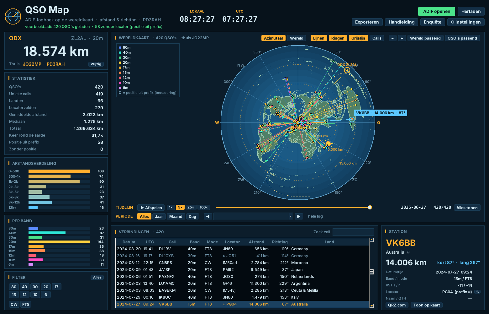

# QSO Map – Handleiding

*Versie 1.2 · gemaakt door Richard Hendriksen PD3RAH · [www.pd3rah.nl](https://www.pd3rah.nl)*

QSO Map laat de verbindingen uit je logboek zien op de wereldkaart. Je opent een ADIF-bestand
(`.adi`) en ziet meteen waar je stations zitten, hoe ver weg ze zijn en in welke richting.

---

## 1. Installeren

1. Download `QSOMap-Setup-x.y.z.exe` van de Releases-pagina op github.com/PD3RAH/qso-map.
2. Start het bestand. Je hebt geen beheerdersrechten nodig en Python zit erbij.
3. Windows kan melden *"Uw pc wordt beschermd"*. Het programma is gratis en niet digitaal
   ondertekend. Klik op *Meer informatie* en daarna op *Toch uitvoeren*.

Na de installatie staat er een snelkoppeling op het bureaublad. Je kunt ook met de rechtermuisknop
op een `.adi`-bestand klikken en **Tonen in QSO Map** kiezen.

## 2. De eerste keer

Bij de eerste start opent het venster **Instellingen**. Vul in:

| Instelling | Uitleg |
|---|---|
| Mijn call | Je roepnaam, bijvoorbeeld PD3RAH. |
| Mijn locator | Je eigen QTH-locator, bijvoorbeeld `JO22mp`. Hiermee worden alle afstanden berekend. |
| Eenheid | Kilometer of mijl. |
| Locator uit ADIF voorrang geven | Staat aan: als de log een `MY_GRIDSQUARE` bevat, wordt die gebruikt (handig voor portable-logs). |

## 3. Een log openen

- Klik op **ADIF openen** (of Ctrl+O) en kies je `.adi`-bestand.
- Gebruik je **CW Station**? Dan staat er een knop **CW Station-logboek** die dat logboek direct opent.
- **Herladen** (F5) leest het bestand opnieuw in, bijvoorbeeld na nieuwe QSO's.

Bijna elk logprogramma kan ADIF exporteren (Log4OM, N1MM, WSJT-X, JTDX, HRD, DXKeeper, QRZ, LoTW,
Club Log). Het originele bestand wordt nooit gewijzigd.

Er zit een voorbeeldlog bij met verzonnen verbindingen: `docs\voorbeeld.adi` in de programmamap.

### Waar komt de positie vandaan?

QSO Map kijkt per verbinding in deze volgorde:

1. `LAT` / `LON` in de log (meest nauwkeurig);
2. `GRIDSQUARE` (het midden van het locatorvak, 4, 6 of 8 tekens);
3. geen van beide: een **schatting uit het prefix** van de roepnaam (het midden van het land,
   bij grote landen zoals de VS, Canada, Australië en Rusland het midden van het call-gebied).

Stations met een geschatte positie zie je op de kaart als **open vierkantje** in plaats van een
rondje, en in de tabel staat dan `≈` voor de locator.

## 4. De kaart

| Knop | Wat het doet |
|---|---|
| **Azimutaal** | Kaart rond jouw QTH. Afstand en richting vanaf huis zijn hier exact: elke rechte lijn vanuit het midden is het kortste pad (grootcirkel). Handig om je beam te richten. |
| **Wereld** | Gewone platte wereldkaart; de lijnen zijn gebogen grootcirkels. |
| **Lijnen** | Lijnen van huis naar elk station, in de kleur van de band. |
| **Ringen** | Afstandsringen (de stap past zich aan de zoom aan) en in de azimutale kaart een windroos. |
| **Grijslijn** | Dag/nacht-grens met de positie van de zon, wordt elke minuut bijgewerkt. |
| **Calls** | Roepnamen naast de stippen (tot 600 tegelijk). |

De kaart is standaard **helder** (blauwe zee, groen land). Liever donker? Kies bij *Instellingen → Kaart* voor **Donker**.
| **− / +** | In- en uitzoomen. Met het muiswiel zoom je rond de muisaanwijzer, dubbelklik zoomt in. |
| **Wereld passend / QSO's passend** | Hele wereld tonen, of precies alle zichtbare verbindingen. |

Slepen met de muis verschuift de kaart. Ga met de muis op een stip staan voor de call en afstand;
klik erop om het station te selecteren. Het verste station (ODX) heeft een ring.

## 5. Station, tabel en statistiek

- **STATION** (rechtsonder): call, land, afstand, richting kort pad en lang pad, datum, band, mode,
  RST, locator en naam/QTH. **QRZ.com** opent het station op QRZ, **Toon op kaart** zoomt erheen.
- **VERBINDINGEN**: alle zichtbare QSO's. Klik op een kolomkop om te sorteren, klik op een regel om
  het station op de kaart te tonen, dubbelklik om erheen te zoomen. **Zoek call** filtert op het
  begin van de roepnaam (bijvoorbeeld `PA` of `DL1`).
- **ODX** linksboven: het verste station met de afstand.
- **STATISTIEK**: aantal QSO's, unieke calls, landen, locatorvelden, gemiddelde en mediaan van de
  afstand, totaal aantal kilometers en hoe vaak dat rond de aarde is.
- **AFSTANDSVERDELING** en **PER BAND**: staafjes met het aantal verbindingen.

## 6. Locator aanpassen

Staat er een verkeerd locatorvak bij een verbinding (of ontbreekt het), dan kun je dat verbeteren:

1. Selecteer de verbinding in de tabel of op de kaart.
2. Klik in het STATION-paneel op **✎** naast *Locator*, of klik met de **rechtermuisknop** op de regel in de tabel.
3. Typ de juiste locator (4, 6 of 8 tekens, bijvoorbeeld `JO22` of `JO22mp`). Je ziet meteen de nieuwe afstand en richting.
4. Werk je vaker met dit station? Zet dan **Ook voor de andere QSO's met …** aan.
5. Klik op **Opslaan** (of Enter).

Aangepaste locators staan in de tabel met **✎**. Je logbestand zelf wordt niet gewijzigd. De aanpassing wordt
per logbestand onthouden in `%APPDATA%\QSOMap\corrections.json`, ook na herstarten. Met
**Exporteren → ADIF** maak je een gecorrigeerd logbestand dat je weer in je logprogramma of bij LoTW/eQSL
kunt gebruiken. **Origineel terugzetten** in hetzelfde venster maakt de aanpassing ongedaan.

## 7. Filteren

Onder **FILTER** staan knoppen voor alle banden en modes die in je log voorkomen. Klik op één of
meer banden en/of modes; alleen die verbindingen blijven zichtbaar op kaart, tabel en statistiek.
**Alles** zet de filters uit.

## 8. Periode: per jaar, maand of dag

Onder de tijdlijn staat **PERIODE**. Daarmee bekijk je een deel van je log:

| Knop | Wat het doet |
|---|---|
| **Alles** | De hele log (standaard). |
| **Jaar** / **Maand** / **Dag** | Alleen dat jaar, die maand of die dag. |
| **◀ ▶** | Naar de vorige of volgende periode waarin je QSO's hebt (lege maanden en dagen worden overgeslagen). |
| Keuzelijst | Kies direct een periode; tussen haakjes staat het aantal QSO's. |

Kaart, tabel, statistiek, ODX en de grafieken laten alleen die periode zien. De tijdlijn speelt dan ook
alleen die periode af. Wissel je van *Jaar* naar *Maand*, dan begint hij bij de eerste maand van dat jaar.
De periode werkt samen met de filters op band, mode en call: zo zie je bijvoorbeeld al je 20m-QSO's in juni 2024.

## 9. Tijdlijn

De tijdlijn speelt je log af in de volgorde waarin je de verbindingen hebt gemaakt.

- **Afspelen** (of de spatiebalk) start en pauzeert. Nieuwe verbindingen lichten kort op.
- **1× 5× 25× 100×** is de snelheid (4, 20, 100 of 400 QSO's per seconde).
- Met de schuif ga je naar een moment in je log; datum en aantal staan rechts.
- **Alles tonen** laat weer de hele log zien.

## 10. Exporteren

**Exporteren** biedt:

- **ADIF met afstand**: een nieuw `.adi`-bestand met het veld `DISTANCE` (km) per QSO, en waar die
  ontbrak de `GRIDSQUARE` en `MY_GRIDSQUARE`. Alleen de zichtbare (gefilterde) QSO's.
- **CSV voor Excel**: met afstand, richting kort/lang pad, positie en bron (`ll`, `grid`, `pfx`).
- **Kaart als PostScript (.eps)**: de kaart als afbeelding. Een schermafdruk kan ook met
  Windows-toets + Shift + S.

## 11. Instellingen

Taal (Nederlands/English), kleurthema (6 kleuren), kaart (helder/donker), call, locator, eenheid en het laatste
bestand openen bij het starten. De instellingen staan in `%APPDATA%\QSOMap`. Het venster schaalt mee met de schermgrootte.

## 12. Automatisch bijwerken

QSO Map kijkt bij het starten op GitHub of er een nieuwe versie is. Is die er, dan vraagt het programma
**"Nu automatisch bijwerken?"**. Kies je *Ja*, dan wordt de update gedownload en gecontroleerd (grootte en
SHA-256-controlegetal), stil geïnstalleerd, en start QSO Map vanzelf opnieuw. Je instellingen en aangepaste
locators blijven bewaard. Bovenin staat dan ook een knop **⬆ Nieuwe versie … – bijwerken**.

Bij *Instellingen*:
- **Automatisch op updates controleren** zet de controle aan of uit;
- **Nu controleren** kijkt meteen;
- **Updates zonder vragen installeren** werkt de volgende keer bij zonder te vragen.

Lukt het automatisch bijwerken niet (bijvoorbeeld door een firewall), dan kun je de downloadpagina openen
en de nieuwe versie gewoon over de oude heen installeren.

## 13. Enquête

Met de knop **Enquête** open je een korte vragenlijst op www.pd3rah.nl (ongeveer 2 minuten). Na de vijfde
keer starten vraagt QSO Map één keer of je die wilt invullen. Je antwoorden gaan alleen per e-mail naar
PD3RAH en worden gebruikt om het programma te verbeteren.

## 14. Vragen en tips

| Probleem | Oplossing |
|---|---|
| Alle afstanden kloppen niet | Controleer je eigen locator bij Instellingen, en of de log een andere `MY_GRIDSQUARE` heeft. |
| Veel open vierkantjes | Je log heeft weinig locators. Laat je logprogramma ze invullen (bijvoorbeeld via QRZ- of HamQTH-lookup) of gebruik een log uit WSJT-X/JTDX. |
| Een `.adx`-bestand opent niet | Dat is de XML-variant van ADIF. Exporteer als `.adi`. |
| "Zonder positie" | QSO's zonder locator én zonder herkenbaar prefix, of /MM- en /AM-stations. |

## 15. Vrijwaring

QSO Map is gratis en wordt geleverd zoals het is, zonder garantie. Afstanden en posities zijn een
benadering. Kaartgegevens: Natural Earth (publiek domein). MIT-licentie, © 2026 Richard A. Hendriksen (PD3RAH).
