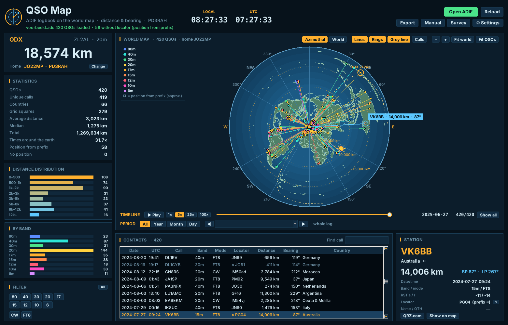

# QSO Map – Manual

*Version 1.2 · made by Richard Hendriksen PD3RAH · [www.pd3rah.nl](https://www.pd3rah.nl)*

QSO Map shows the contacts in your logbook on a world map. Open an ADIF file (`.adi`) and you see
straight away where your stations are, how far away they are and in which direction.

---

## 1. Installation

1. Download `QSOMap-Setup-x.y.z.exe` from the Releases page at github.com/PD3RAH/qso-map.
2. Run it. No admin rights are needed and Python is included.
3. Windows may show *"Windows protected your PC"*: the program is free and not code-signed.
   Click *More info* and then *Run anyway*.

After installation there is a desktop shortcut. You can also right-click an `.adi` file and choose
**Show on QSO Map**.

## 2. First start

The **Settings** window opens on the first start. Fill in:

| Setting | Meaning |
|---|---|
| My call | Your callsign. |
| My locator | Your own grid square, e.g. `JO22mp`. All distances are calculated from it. |
| Units | Kilometres or miles. |
| Prefer locator from ADIF | On: if the log contains `MY_GRIDSQUARE`, that is used (handy for portable logs). |

## 3. Opening a log

- Click **Open ADIF** (or Ctrl+O) and pick your `.adi` file.
- Using **CW Station**? A **CW Station logbook** button opens that logbook directly.
- **Reload** (F5) reads the file again, for example after new QSOs.

Almost every logging program exports ADIF (Log4OM, N1MM, WSJT-X, JTDX, HRD, DXKeeper, QRZ, LoTW,
Club Log). The original file is never changed. An example log with fictitious contacts is included:
`docs\voorbeeld.adi` in the program folder.

### Where does the position come from?

1. `LAT` / `LON` in the log (most accurate);
2. `GRIDSQUARE` (centre of the grid square, 4, 6 or 8 characters);
3. neither: an **estimate from the callsign prefix** (centre of the country; for large countries
   such as the USA, Canada, Australia and Russia the centre of the call area).

Stations with an estimated position are drawn as an **open square** instead of a dot, and the table
shows `≈` before the locator.

## 4. The map

| Button | What it does |
|---|---|
| **Azimuthal** | Map centred on your QTH. Distance and bearing from home are exact: every straight line from the centre is the short path (great circle). Use it to point your beam. |
| **World** | Flat world map; the lines are curved great circles. |
| **Lines** | Lines from home to each station, in the colour of the band. |
| **Rings** | Distance rings (step follows the zoom) and, in the azimuthal map, a compass rose. |
| **Grey line** | Day/night boundary with the sun position, updated every minute. |
| **Calls** | Callsigns next to the dots (up to 600 at once). |

The map is **bright** by default (blue sea, green land). Prefer dark? Choose **Dark** under *Settings → Map*.
| **− / +** | Zoom out / in. The mouse wheel zooms around the pointer, double-click zooms in. |
| **Fit world / Fit QSOs** | Show the whole world, or exactly all visible contacts. |

Drag with the mouse to pan. Hover over a dot to see call and distance; click it to select the
station. The farthest station (ODX) has a ring.

## 5. Station, table and statistics

- **STATION**: call, country, distance, short-path and long-path bearing, date, band, mode, RST,
  locator and name/QTH. **QRZ.com** opens the station on QRZ, **Show on map** zooms to it.
- **CONTACTS**: all visible QSOs. Click a column header to sort, a row to show the station on the
  map, double-click to zoom to it. **Find call** filters on the start of the callsign.
- **ODX**, **STATISTICS**, **DISTANCE DISTRIBUTION** and **BY BAND** summarise what is visible.

## 6. Editing a locator

If a contact has a wrong (or missing) grid square, you can correct it:

1. Select the contact in the table or on the map.
2. Click **✎** next to *Locator* in the STATION panel, or **right-click** the row in the table.
3. Type the correct locator (4, 6 or 8 characters, e.g. `JO22` or `JO22mp`). The new distance and bearing are shown immediately.
4. Optionally switch on **Also for the other QSOs with …**.
5. Click **Save** (or press Enter).

Edited locators are marked **✎** in the table. Your log file itself is not changed. The correction is remembered
per log file in `%APPDATA%\QSOMap\corrections.json`, also after a restart. Use **Export → ADIF** to create a
corrected log file for your logger or for LoTW/eQSL. **Restore original** in the same window undoes it.

## 7. Filters

**FILTER** has buttons for every band and mode in your log. Select one or more; only those contacts
stay visible on the map, in the table and in the statistics. **All** clears the filters.

## 8. Period: by year, month or day

Below the timeline is **PERIOD**, to look at part of your log:

| Button | What it does |
|---|---|
| **All** | The whole log (default). |
| **Year** / **Month** / **Day** | Only that year, month or day. |
| **◀ ▶** | Previous or next period with QSOs (empty months and days are skipped). |
| Drop-down list | Pick a period directly; the number of QSOs is shown in brackets. |

The map, table, statistics, ODX and charts show only that period, and the timeline plays back only that period.
Switching from *Year* to *Month* starts at the first month of that year. The period works together with the band,
mode and call filters, e.g. all your 20m QSOs in June 2024.

## 9. Timeline

The timeline plays back your log in the order the contacts were made.

- **Play** (or the space bar) starts and pauses. New contacts flash briefly.
- **1× 5× 25× 100×** sets the speed (4, 20, 100 or 400 QSOs per second).
- The slider jumps to a moment in your log; date and count are shown on the right.
- **Show all** shows the whole log again.

## 10. Export

- **ADIF with distance**: a new `.adi` file with the `DISTANCE` field (km) for each QSO, plus
  `GRIDSQUARE` and `MY_GRIDSQUARE` where they were missing. Only the visible (filtered) QSOs.
- **CSV for Excel**: with distance, short/long path bearing, position and its source (`ll`, `grid`, `pfx`).
- **Map as PostScript (.eps)**. A screenshot also works with Windows key + Shift + S.

## 11. Settings

Language (Nederlands/English), colour theme (6 colours), map (bright/dark), call, locator, units and opening
the last file at start-up. Settings are stored in `%APPDATA%\QSOMap`. The window scales with the screen size.

## 12. Automatic updates

At start-up QSO Map checks GitHub for a new version. If there is one, it asks **"Update automatically now?"**.
Choose *Yes* and the update is downloaded, verified (size and SHA-256 checksum), installed silently, and QSO Map
restarts by itself. Your settings and edited locators are kept. A **⬆ New version … – update** button also
appears at the top.

In *Settings*:
- **Check for updates automatically** turns the check on or off;
- **Check now** checks straight away;
- **Install updates without asking** updates next time without asking.

If the automatic update fails (for example because of a firewall), open the download page and simply install
the new version over the old one.

## 13. Survey

The **Survey** button opens a short questionnaire on www.pd3rah.nl (about 2 minutes). After the fifth start
QSO Map asks once whether you would like to fill it in. Your answers are only e-mailed to PD3RAH and are used
to improve the program.

## 14. Troubleshooting

| Problem | Solution |
|---|---|
| All distances are wrong | Check your own locator in Settings, and whether the log has a different `MY_GRIDSQUARE`. |
| Many open squares | Your log has few grid squares. Let your logger fill them in (QRZ/HamQTH lookup) or use a WSJT-X/JTDX log. |
| An `.adx` file does not open | That is the XML variant of ADIF. Export as `.adi`. |
| "No position" | QSOs without a grid square and without a recognised prefix, or /MM and /AM stations. |

## 15. Disclaimer

QSO Map is free and provided as is, without warranty. Distances and positions are approximate.
Map data: Natural Earth (public domain). MIT License, © 2026 Richard A. Hendriksen (PD3RAH).
